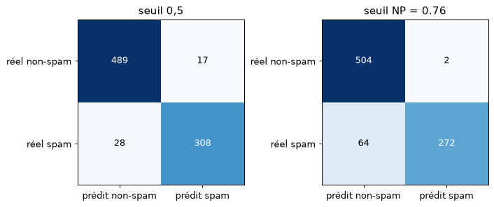
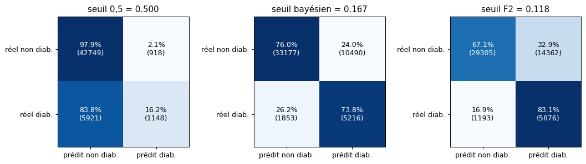

# Note de Amaury : utilisation de l'IA pour la mise en page du fichier

# Binary Classification: Spam Detection and Diabetes Screening

Course project for the Machine Learning unit of the TAF MCE (Mathematical and Computational Engineering),
IMT Atlantique, 2026.
**Authors**: Amaury JANIN, Anthony DER KEVORKIAN, Lucas OZEL.

## Project brief

The goal is to build **one machine learning workflow** and apply it, unchanged, to **two binary classification
datasets**, while following good software engineering practices: version control with Git, collaborative
development and reproducible code.

### Datasets

| Dataset | Rows | Features | Positive class | Main difficulty |
|---|---|---|---|---|
| [Spambase](https://archive.ics.uci.edu/dataset/94/spambase) (UCI) | 4,601 | 57 continuous | 39% spam | sparse, heavy-tailed features; false positives (legitimate e-mail flagged as spam) are very costly |
| [Diabetes Health Indicators](https://www.kaggle.com/datasets/alexteboul/diabetes-health-indicators-dataset) (BRFSS 2015) | 253,680 | 21 binary / ordinal | 14% diabetic or prediabetic | imbalanced classes, large volume, limited information |

### Required workflow

1. Import the dataset.
2. Clean and pre-process the data: impute missing values (mean or median), center and scale, apply a PCA.
3. Split the data into a training set and a test set.
4. Train the models, including **feature selection**.
5. Validate the models.


## Repository structure

```
.
├── ml_workflow.py      # every function of the workflow (single module)
├── spam.ipynb          # workflow applied to Spambase, with commented results
├── diabetes.ipynb      # workflow applied to Diabetes, with commented results
├── data/               # both datasets
├── figures/            # figures used in this README
└── requirements.txt
```

The notebooks and code comments are written in French.

## Installation and usage

```bash
git clone <repository-url>
cd <repository>
python -m venv .venv
source .venv/bin/activate          # Windows: .venv\Scripts\activate
pip install -r requirements.txt
jupyter notebook                   # then open spam.ipynb or diabetes.ipynb
```

Run the notebooks **from the repository root** (data paths are relative: `data/...`). They are committed with
their outputs; a full *Restart & Run All* takes about 1 minute (Spambase) and 4 minutes (Diabetes) on a recent laptop.
All random seeds are fixed, so the results are reproducible.

## How the workflow is implemented

| Step | Functions in `ml_workflow.py` |
|---|---|
| 1. Import | `load_spambase` (reads column names from `spambase.names`), `load_diabetes`, `describe_dataset` (shape, missing values, duplicates, class balance), `variable_types` |
| 2. Pre-processing | `remove_duplicates`, median imputation, `log1p` transform, `StandardScalerManual`, `PCAManual`, all assembled by `build_pipeline` |
| 3. Split | `split_data` (stratified 80/20), `make_cv` (stratified k-fold cross-validation) |
| 4. Training and feature selection | `get_models` (11 classifi
ers), `tune_model` (grid or randomized search), `rank_features` (ANOVA F-test, mutual information, L1 penalty, permutation importance), `cv_score_vs_k`; selectors (`SelectKBest`, L1 `SelectFromModel`, `RFECV`) plugged into the pipeline |
| 5. Validation | metrics computed from the confusion matrix (`confusion_counts`, `compute_metrics`), `cross_validate_models`, decision-threshold selection on out-of-fold scores (`neyman_pearson_threshold`, `bayes_risk_threshold`, `fbeta_threshold`), `evaluate_on_test`, `plot_*` helpers |

**No information from the test set is ever used for training.** Imputation, scaling, PCA, feature selection and
resampling are `Pipeline` steps, re-fitted inside every cross-validation fold, and the test set is used only once,
at the end of each notebook. The Spambase notebook shows why this matters: selecting features outside
cross-validation yields 92% accuracy on purely random labels, against 51% when selection is done inside the pipeline.

### Course algorithms implemented from scratch

| Class / function | What it does | Checked in the notebooks |
|---|---|---|
| `StandardScalerManual` | $z = (x-\mu)/\sigma$, with $\mu$ and $\sigma$ learned on the training set | identical to `StandardScaler` |
| `PCAManual` | eigendecomposition of the covariance matrix; number of components chosen by explained variance | same variances and axes as `PCA` |
| `GaussianBayesClassifier` | Gaussian Bayes classifier (MAP rule): LDA (shared covariance), QDA, Gaussian naive Bayes | same predictions as `LinearDiscriminantAnalysis` |
| `LogisticRegressionGD` | logistic regression trained by accelerated (Nesterov) gradient descent, step $1/L$, class weights | same coefficients as `LogisticRegression` |
| `confusion_counts`, `compute_metrics` | confusion matrix, precision, recall, specificity, F-β, balanced accuracy | |
| `neyman_pearson_threshold` | threshold maximising recall subject to false-positive rate ≤ α (Neyman-Pearson lemma) | |
| `bayes_risk_threshold` | threshold minimising the Bayes risk, $c_{FP}/(c_{FP}+c_{FN})$ | |

The other models (k-NN, SVM, decision tree, random forest, gradient boosting, MLP), the feature-selection filters and
the resampling methods (`imbalanced-learn`) come from libraries.


## Main results

| | Spambase | Diabetes |
|---|---|---|
| Cost of errors | a false positive hides a legitimate e-mail: very costly | a false negative is an undetected diabetes; a false positive is an unnecessary blood test |
| Model comparison (threshold-free) | ROC AUC, and recall at a 1% false-positive rate | PR AUC (average precision), plus ROC AUC |
| Decision threshold | Neyman-Pearson: maximise recall with a false-positive rate ≤ 1% | maximise F2 (recall counts twice as much as precision) |
| **Selected model** | **Random Forest, 57 features, Neyman-Pearson threshold = 0.76** | **Gradient Boosting, 21 features, F2 threshold = 0.118** |
| Test set | ROC AUC 0.989; **0.4% false positives**; 81% of spam detected; precision 99.3% | PR AUC 0.42 (0.14 at random); ROC AUC 0.83; **83% of diabetics detected**; precision 29% |

In both cases **the decision threshold matters as much as the model**. On Spambase, the Neyman-Pearson threshold cuts
false positives from 17 to 2 legitimate e-mails out of 506; on Diabetes, lowering the threshold raises recall from 16%
to 83%.

<p align="center">
  
  
</p>

The same workflow leads to similar conclusions on both datasets: tree ensembles are the best models, PCA and feature
selection do not improve the score, and the hand-written LDA stays close to logistic regression. The datasets differ
in how separable they are (ROC AUC 0.99 against 0.83) and in the direction of the threshold: it is raised on Spambase
to avoid false positives and lowered on Diabetes to detect rare positives. Each notebook ends with a detailed
conclusion and the limits of the study.

## Use of AI

Amaury : AI used for debugging and for the tests on the functions as well as their description. The README was also made using AI since I don't know the formatting well, however the structure and arguments were made my me.

Anthony: AI was used as a support tool to clarify some theoretical concepts of the course before implementing them, for debugging and for writing tests on some functions, and to help with the wording of the documentation and comments.

## Data sources

- **Spambase**: M. Hopkins, E. Reeber, G. Forman and J. Suermondt (1999),
  [UCI Machine Learning Repository](https://archive.ics.uci.edu/dataset/94/spambase), CC BY 4.0 licence.
- **Diabetes Health Indicators**: A. Teboul,
  [Kaggle](https://www.kaggle.com/datasets/alexteboul/diabetes-health-indicators-dataset), a cleaned version of the
  CDC's 2015 Behavioral Risk Factor Surveillance System (BRFSS) survey; see the Kaggle page for terms of use.
